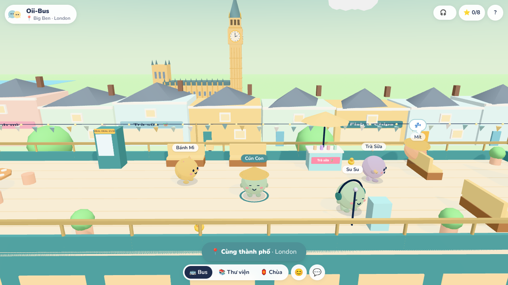
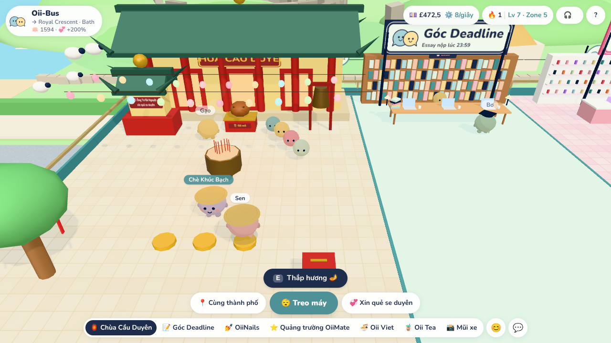
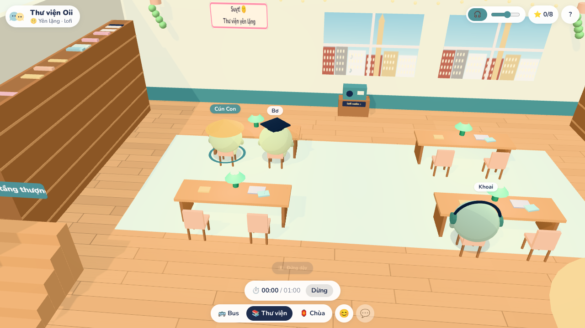
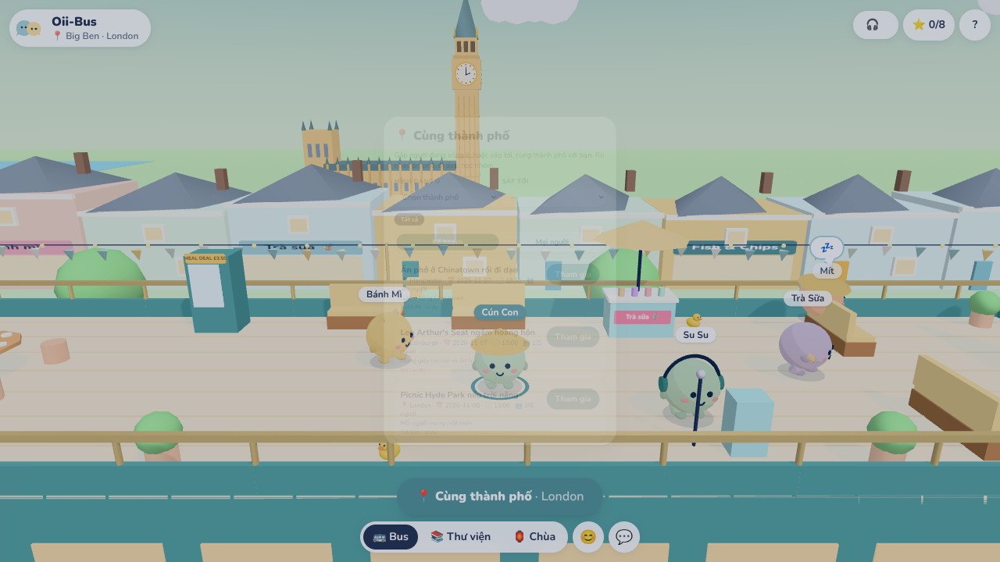

<div align="center">

# Oii-Bus

**A cosy 3D bus touring the UK, where Vietnamese students hang out, study together, and meet new people.**

_Thích ở một mình nhưng thỉnh thoảng sợ cô đơn._

[](https://github.com/tonyfromvietnam/oii-bus/actions/workflows/ci.yml)
[](https://github.com/tonyfromvietnam/oii-bus/actions/workflows/pages.yml)
[](https://github.com/tonyfromvietnam/oii-bus/actions/workflows/codeql.yml)


[](LICENSE)
[](CONTRIBUTING.md)

[**Live prototype**](https://tonyfromvietnam.github.io/oii-bus/) · [Architecture](docs/ARCHITECTURE.md) · [World design](docs/WORLD.md) · [Deploy](docs/DEPLOY.md) · [Changelog](CHANGELOG.md)



</div>

---

## About

Oii-Bus is the open-source companion world to **[OiiMate](https://oii-mate.com)**, the anonymous 1:1 Messenger chat for Vietnamese students in the UK.
OiiMate gives you _someone to talk to_; Oii-Bus gives you _somewhere with people_.

Everyone rides one giant three-floor bus that loops past 28 UK landmarks, from Big Ben to the Giant's Causeway.
Characters are round, cute OiiMate-style mascots; controls are deliberately simple (fixed camera, tap-to-walk, joystick on mobile).

> **Status:** playable offline prototype (single player with bot companions). Real-time multiplayer, accounts and voice are on the [roadmap](#roadmap).

## Features

| Floor                           | What you do there                                                                                                                                                                                                                                |
| ------------------------------- | ------------------------------------------------------------------------------------------------------------------------------------------------------------------------------------------------------------------------------------------------ |
| 🚌 **Top deck: Cùng thành phố** | Watch the UK go by, find people who live in (or are visiting) your city, create and join meetup plans. Bubble tea, karaoke, a shared hotpot and hidden rubber ducks.                                                                             |
| 📚 **Library**                  | Quiet floor: text chat is off, generated lofi plays, one tap sits you at a desk and starts a focus timer.                                                                                                                                        |
| 🏮 **Chùa Cầu Duyên**           | A Vietnamese-Korean temple courtyard. Light incense, chant, ring the bell, tie a red thread or donate (virtual £) to earn _phúc đức_, then ask Ông Tơ Bà Nguyệt for an anonymous 1:1 match. More merit → better odds (capped, never guaranteed). |

Plus weekly side quests with a "UK passport" of stamps, proximity chat bands, block/report flows and a Vietnamese UI written in a friendly northern tone.

<table>
  <tr>
    <td></td>
    <td></td>
    <td></td>
  </tr>
  <tr align="center">
    <td>Chùa Cầu Duyên</td>
    <td>Library focus mode</td>
    <td>Same-city plans</td>
  </tr>
</table>

## Tech stack

| Area     | Choice                                                                                        |
| -------- | --------------------------------------------------------------------------------------------- |
| Monorepo | pnpm workspaces + Turborepo                                                                   |
| Web      | Vite, React 18, TypeScript (strict), three.js via React Three Fiber, Zustand, Tailwind CSS v4 |
| Server   | Node 22, Fastify (+ Colyseus for real-time rooms, planned)                                    |
| Data     | PostgreSQL + Prisma, Redis (sessions, rate limits, match queue)                               |
| Voice    | LiveKit with server-controlled proximity subscriptions (planned)                              |
| Quality  | ESLint, Prettier, Vitest, Playwright, CodeQL, Dependabot                                      |
| Delivery | GitHub Actions → GitHub Pages (prototype); Fly.io + Cloudflare (full stack)                   |

## Getting started

**Requirements:** Node.js ≥ 22 and pnpm 9 (`corepack enable`). Docker is optional (Postgres, Redis, LiveKit for local dev).

```bash
git clone https://github.com/tonyfromvietnam/oii-bus.git
cd oii-bus
pnpm install
pnpm dev
```

Open <http://localhost:5173/?preview> to board the bus straight away (skips the weekend opening hours).
`pnpm dev` creates `.env` from [`.env.example`](.env.example), starts Docker services if available, and runs the web app and API in watch mode.

### Scripts

| Command                                     | Description                                                  |
| ------------------------------------------- | ------------------------------------------------------------ |
| `pnpm dev`                                  | Infrastructure + web (`:5173`) + API (`:2567`)               |
| `pnpm lint`                                 | ESLint and Prettier check                                    |
| `pnpm format`                               | Format everything with Prettier                              |
| `pnpm typecheck`                            | `tsc` across all packages                                    |
| `pnpm test`                                 | Vitest unit tests across all packages                        |
| `pnpm build`                                | Production build of web and server                           |
| `pnpm --filter @oii-bus/web test:e2e`       | Playwright smoke tests (desktop + mobile)                    |
| `pnpm --filter @oii-bus/web build:artifact` | Static prototype build (`index.html` + `app.js` + `app.css`) |

URL flags: `?preview` (enter outside opening hours), `?lowfx` (no shadows, for low-end devices and CI).

## Project structure

```text
apps/
  web/        3D client and UI (React Three Fiber, Tailwind)
  server/     Fastify API (+ Colyseus rooms in M2)
packages/
  shared/     Constants, zod schemas, opening hours, proximity, merit and matching logic
  world/      Scenes (bus, library, temple), colliders, seats, spots, UK route
prisma/       Database schema
docs/         Architecture, world design, deployment, getting started
```

Game rules that must agree between client and server (collision, proximity bands, merit caps, matching) live in `packages/*` as pure functions with unit tests.

## Roadmap

- [x] **M0** Monorepo, CI, Docker Compose, architecture
- [x] **M1** 3D world: three floors, 28 landmarks, quests, temple, same-city planner, mobile controls
- [ ] **M2** Real-time multiplayer (Colyseus): shared floors, server-filtered proximity chat, instances
- [ ] **M3** Accounts: OiiMate magic link, `.ac.uk` OTP fallback, invite and alumni codes, trust tiers
- [ ] **M4** Proximity voice (LiveKit), push-to-talk
- [ ] **M5** Moderation and admin panel, real 1:1 matching, quest review, privacy page, staging deploy

## Deployment

The prototype deploys automatically to GitHub Pages on every push to `main`; see [docs/GETTING_STARTED.md](docs/GETTING_STARTED.md).
The full stack (API, database, Redis, LiveKit, email) is described in [docs/DEPLOY.md](docs/DEPLOY.md).

## Contributing

Oii-Bus is open source and contributions are very welcome: new landmarks, translations, bug fixes, accessibility and performance work.
Look for issues labelled [`good first issue`](https://github.com/tonyfromvietnam/oii-bus/labels/good%20first%20issue). Please read [CONTRIBUTING.md](CONTRIBUTING.md) and our [Code of Conduct](CODE_OF_CONDUCT.md) first.
Report security issues privately as described in [SECURITY.md](SECURITY.md).

## Tiếng Việt

Oii-Bus là "người bạn đồng hành" của OiiMate: một chiếc bus 3D ba tầng chạy vòng quanh UK. Tầng thượng tìm người cùng thành phố và rủ nhau đi chơi, tầng giữa là thư viện yên lặng nghe lofi, tầng dưới cùng là Chùa Cầu Duyên để thắp hương, tích phúc đức và xin quẻ se duyên 1:1.
Tài liệu kỹ thuật chi tiết (tiếng Việt) nằm trong thư mục [`docs/`](docs/).

## License

[MIT](LICENSE) © 2026 Duy Chinh Dinh and Oii-Bus contributors.

Oii-Bus is an independent fan-made world; UK landmarks are depicted as stylised toy models for illustration.
