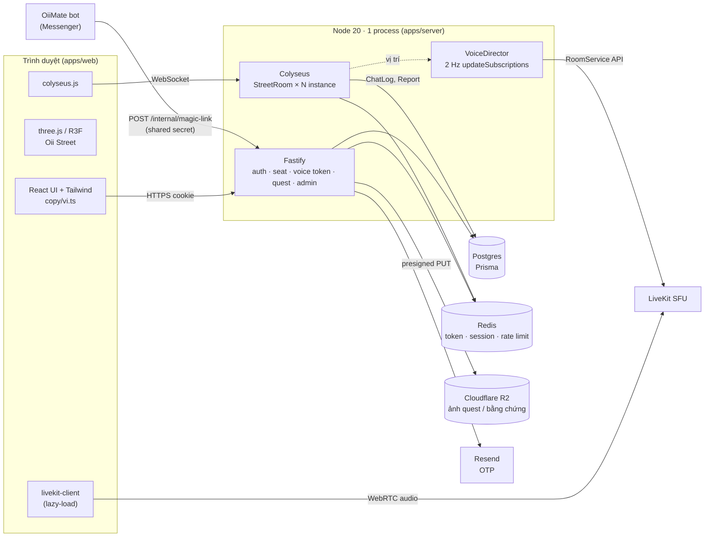
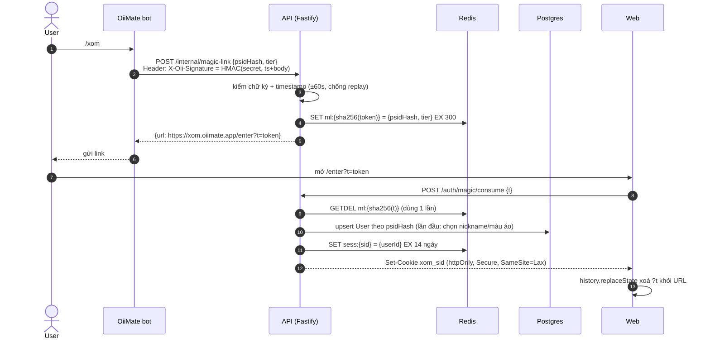
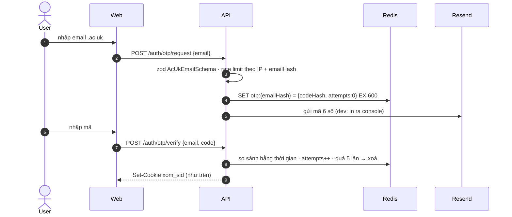
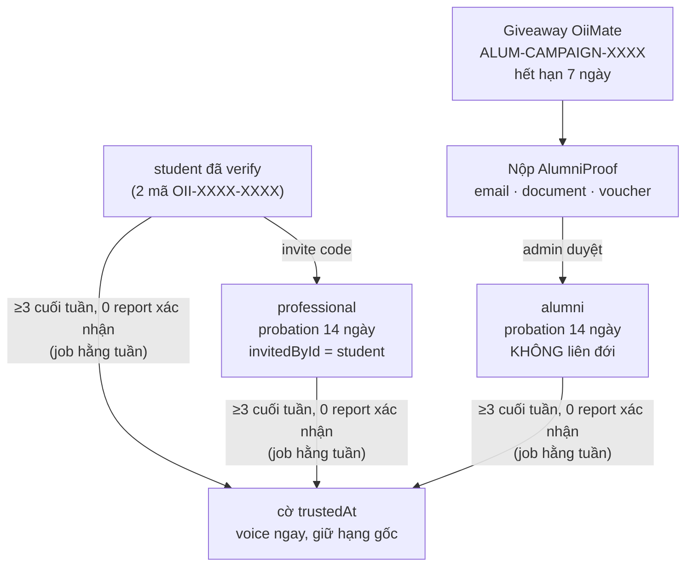
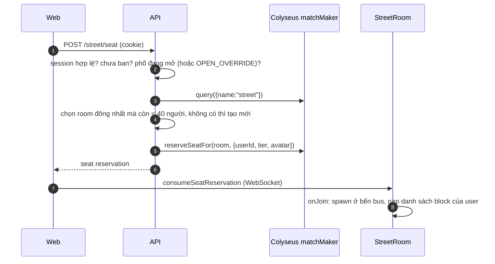
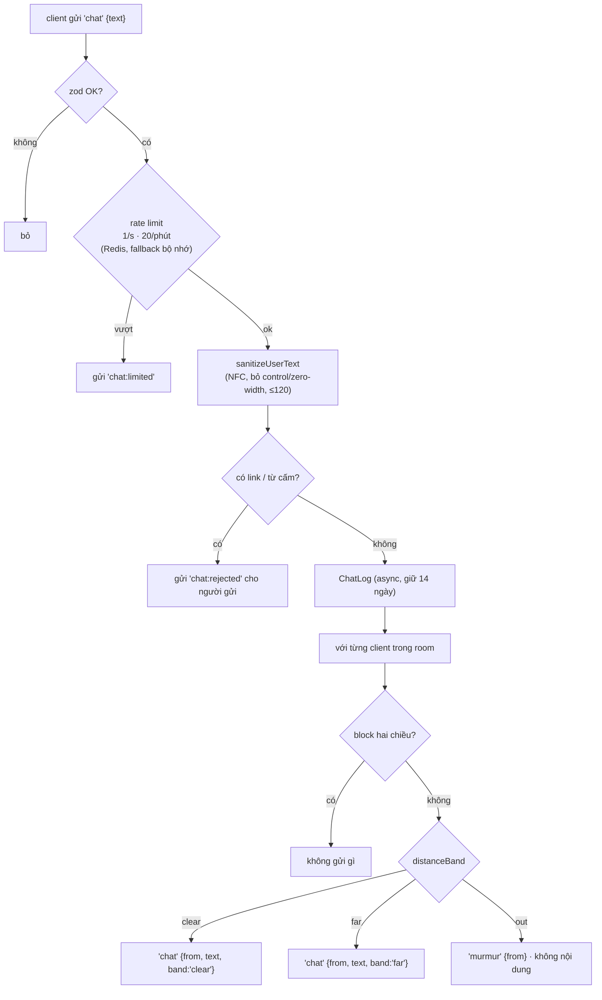
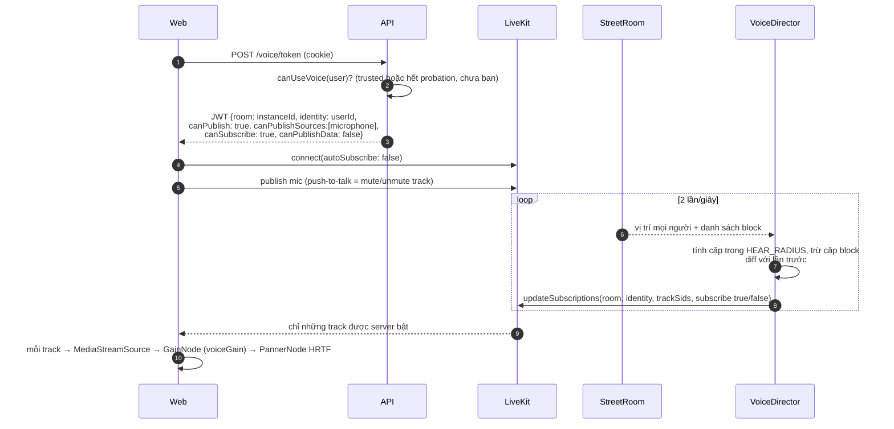
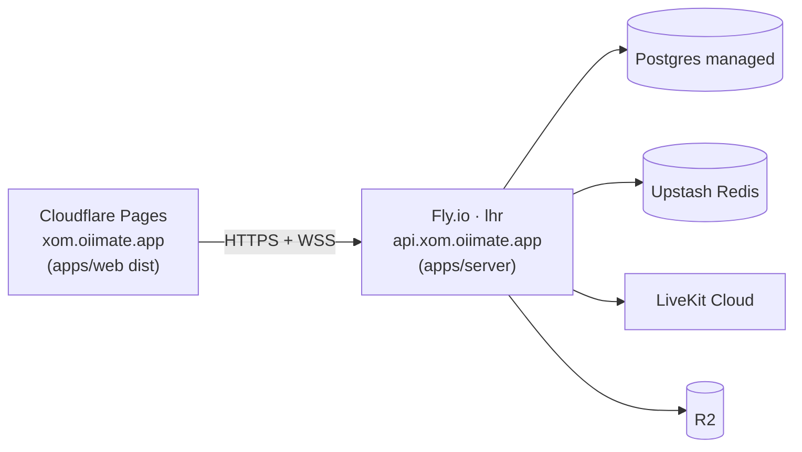

# Kiến trúc Xóm Oii (đề xuất v1)

> Trạng thái: đã review sau M0. Các quyết định nằm ở [mục 9](#9-quyết-định-đã-chốt-review-m0).

## 1. Tổng quan

**Nguyên tắc xuyên suốt**

1. **Server là nguồn sự thật**: vị trí, tốc độ, bus, NPC, ai nhận được tin chat nào, ai nghe được ai.
2. **Client chỉ nhận cái nó được phép biết**: text chat của người ở xa không bao giờ rời server; track voice của người ở xa không bao giờ được subscribe.
3. **Dữ liệu thế giới dùng chung**: `packages/world` (collider, seats, spots) chạy y hệt ở client (dự đoán) và server (validate).
4. **Mọi payload vào server đi qua zod** trong `packages/shared`.
5. **Ẩn danh**: không có tên thật; email/psid chỉ là hash (SHA-256 + pepper).

## 2. Các package

| Package           | Vai trò                                                                                                                                                                |
| ----------------- | ---------------------------------------------------------------------------------------------------------------------------------------------------------------------- |
| `packages/shared` | Hằng số (`CLEAR_RADIUS`, `HEAR_RADIUS`, rate limit, giờ mở…), zod schema client→server, hàm thuần: giờ mở cửa theo London, `distanceBand`, `voiceGain`, sanitize text. |
| `packages/world`  | Hệ toạ độ phố, AABB collider, seats, spots, layout Oii Street, `resolveCollisions` tất định.                                                                           |
| `apps/server`     | Fastify (HTTP) + Colyseus (WebSocket) trên **cùng một HTTP server**. Bundle bằng tsup.                                                                                 |
| `apps/web`        | Vite + React 18 + R3F. Admin là route `/admin` lazy-load trong web (không tách app riêng ở v1).                                                                        |
| `prisma/`         | Schema Postgres (brief §6), migrations.                                                                                                                                |

Package nội bộ xuất thẳng TypeScript nguồn (`exports: ./src/index.ts`): Vite và tsx đọc trực tiếp, tsup bundle vào khi build server. Không cần bước build riêng cho package.

## 3. Luồng auth

### 3.1 Magic link từ OiiMate bot (luồng chính)

- Token 32 byte ngẫu nhiên, chỉ lưu **hash** trong Redis, TTL 5 phút, `GETDEL` để đảm bảo dùng một lần.
- Bot ký request bằng HMAC thay vì gửi secret trần, kèm timestamp để chặn replay.
- Session lưu ở Redis (không phải JWT) để **ban có hiệu lực ngay**: ban → xoá mọi `sess:*` của user + kick khỏi room.

### 3.2 OTP `.ac.uk` (dự phòng)

Email **không bao giờ** được ghi xuống Postgres; chỉ `emailHash = sha256(pepper + lower(email))` để chống tạo trùng tài khoản.

### 3.3 Mã mời, mã alumni, hạng

- Dùng mã: transaction `UPDATE InviteCode SET usedById=… WHERE code=… AND usedAt IS NULL AND (expiresAt IS NULL OR expiresAt > now())` để tránh race dùng 2 lần.
- **Ban liên đới**: `banUser(userId)` trong một transaction: đặt `bannedAt`, nếu user có `invitedById` và mã là `kind=invite` thì ban luôn inviter (`banReason = "liên đới: <invitee>"`), ghi `AuditLog` cho từng người, sau đó thu hồi session + kick khỏi room. Admin panel hiện **cây invite** trước khi xác nhận.

## 4. Realtime (Colyseus)

### 4.1 Vào phố và chọn instance

Ghép vào instance "gần đầy" trước để phố không loãng (brief §11). Việc kiểm tra auth/giờ mở/ban nằm ở một chỗ duy nhất (`/street/seat`), Colyseus chỉ nhận người có seat reservation hợp lệ.

### 4.2 StreetRoom

- **Tick mô phỏng 20 Hz**, `patchRate = 100 ms` (snapshot 10 Hz). Client gửi input 15 Hz và nội suy snapshot.
- **State** (`@colyseus/schema`): `players` (x, z, ry, pose, gesture, seatId, holding), `bus` (x, phase, doorsOpen), `npcs` (Dave, bồ câu), `clock` (giờ London cho ánh sáng, sự kiện giờ chung).
- **Validate input** cho mỗi `InputMessage`:
  1. zod parse; 2. `dist / dt ≤ MAX_SPEED × tolerance`, sai thì snap về vị trí server; 3. `resolveCollisions` bằng cùng collider với client; 4. đang ngồi/trên bus thì bỏ qua di chuyển.
- **"Đang gõ…"**: field `typing` gắn `@view(NEAR)`. Mỗi tick, với từng client, server thêm/bớt tag `NEAR` (qua `StateView`) cho người chơi khác trong `HEAR_RADIUS`, nên chỉ người đủ gần mới thấy.
- **Bus N29**: máy trạng thái trên server (`approaching → stopped 14s → departing → offscreen 10–18s`). Lên bus khi `stopped`, xuống ở lần `stopped` kế tiếp; người trên bus có vị trí gắn với bus.

### 4.3 Chat chữ theo khoảng cách

Chat **không** nằm trong state (state thì ai cũng nhận). Server dùng `client.send` riêng cho từng người, nên client ở xa không bao giờ nhận được text.

## 5. Voice (LiveKit)

- Client **không có quyền tự subscribe**: token không thể làm gì hơn ngoài những track server đã bật cho nó, nên không nghe lén được người ở xa.
- `VoiceDirector` chỉ gửi **thay đổi** (diff) để giảm số lần gọi API. 40 người × 2 Hz vẫn nằm trong giới hạn.
- Âm thanh không gian ở client: vị trí panner cập nhật theo avatar mỗi frame; gain giảm tuyến tính từ 1 (≤ 4.5 m) xuống 0 (9 m) bằng `voiceGain` dùng chung.
- `livekit-client` được **lazy-load** khi user bật voice, để giữ bundle khởi động < 600 KB gzip.
- Report voice chỉ lưu metadata (ai, lúc nào, instance). **Không ghi âm.**

## 6. Dữ liệu và lưu trữ

| Nơi      | Dữ liệu                                                                                                                                 |
| -------- | --------------------------------------------------------------------------------------------------------------------------------------- |
| Postgres | User, InviteCode, AlumniProof, Block, Report, ChatLog (14 ngày), Quest, QuestSubmission, Stamp, AuditLog                                |
| Redis    | `ml:*` magic-link (5 phút), `otp:*` (10 phút), `sess:*` (14 ngày), `rl:chat:*`, cờ override giờ mở                                      |
| R2       | Ảnh quest, ảnh bằng chứng alumni. Upload bằng presigned PUT, chỉ admin đọc qua presigned GET. Ảnh bằng chứng bị xoá sau khi duyệt xong. |

Job định kỳ (chạy trong cùng process ở v1, dùng khoá Redis để chỉ một instance chạy): xoá ChatLog > 14 ngày, nâng `trusted`, dọn mã hết hạn.

## 7. Bảo mật

- Cookie `xom_sid`: httpOnly, Secure, SameSite=Lax, domain `xom.oiimate.app`. Web và API chung site (ví dụ `xom.oiimate.app` và `api.xom.oiimate.app`) để cookie đi kèm cả request HTTP lẫn WebSocket.
- Các request thay đổi dữ liệu phải có header `X-Requested-With` và kiểm `Origin` để chống CSRF.
- Text người dùng chỉ render bằng `textContent` / JSX text. ESLint chặn `innerHTML` và `dangerouslySetInnerHTML` trong `apps/web`.
- Endpoint `/internal/*` chỉ nhận request có HMAC hợp lệ; `/admin/*` yêu cầu `role = admin`, mọi hành động đều ghi AuditLog.

## 8. Triển khai

- v1 chạy **một process** (Fastify + Colyseus). Đủ cho vài trăm người đồng thời (nhiều instance 40 người trong một process).
- Khi cần scale ngang: bật `RedisPresence` + `RedisDriver` của Colyseus, chạy nhiều máy Fly sau load balancer có sticky session; `/street/seat` vẫn chọn instance qua matchMaker dùng chung.
- Chi tiết sẽ ở `docs/DEPLOY.md` (M5).

## 9. Quyết định đã chốt (review M0)

1. **Ban liên đới một cấp**: chỉ ban inviter trực tiếp, không đệ quy.
2. **`trusted` là cờ** (`trustedAt`), không phải hạng. `Tier` = `student | alumni | professional`.
3. **Domain**: production `xom.oiimate.app` + `api.xom.oiimate.app`. Giai đoạn đầu: staging tạm trên `duychinhdinh.com`.
4. **Từ cấm**: team OiiMate cung cấp danh sách, đặt ở `packages/shared/src/wordlist/`.
5. **Bot**: team bot thêm lệnh `/xom` và ký HMAC theo §3.1.
