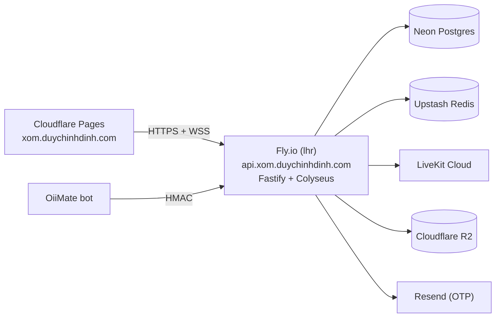

# Triển khai Xóm Oii

Có hai giai đoạn. **A** dùng được ngay hôm nay. **B** là bản thật nhiều người chơi (sau M2–M5).

## A. Prototype tĩnh (offline, một người + bot)

Toàn bộ app là **một file HTML** (~1,2 MB, ~345 KB gzip), không cần server.

```bash
pnpm install
pnpm --filter @xom-oii/web build:standalone
# → apps/web/dist-standalone/index.html
```

Chọn một trong các cách sau:

| Cách                            | Cần gì                                               | Kết quả                                               |
| ------------------------------- | ---------------------------------------------------- | ----------------------------------------------------- |
| Thêm vào repo website hiện có   | Quyền push repo website + biết site build/host ở đâu | `duychinhdinh.com/xom/`                               |
| Cloudflare Pages (kéo thả file) | Tài khoản Cloudflare                                 | `xom-oii.pages.dev`, rồi CNAME `xom.duychinhdinh.com` |
| GitHub Pages từ repo `xom-oii`  | Repo `xom-oii` + bật Pages                           | `<user>.github.io/xom-oii`                            |

Tham số URL hữu ích: `?lowfx` (máy yếu: tắt bóng đổ), `?preview` (bỏ qua giờ mở cửa khi chạy bản có server).

## B. Bản thật (realtime, đăng nhập, voice)



### Cần chuẩn bị (checklist)

| #   | Thứ cần có                                   | Dùng cho                                                | Ghi chú                                               |
| --- | -------------------------------------------- | ------------------------------------------------------- | ----------------------------------------------------- |
| 1   | Repo GitHub `xom-oii` (Claude có quyền push) | Code, CI                                                | Cài Claude GitHub App cho repo                        |
| 2   | Domain + quyền sửa DNS                       | `xom.` (web), `api.xom.` (server)                       | Web và API phải chung site để cookie đi qua WebSocket |
| 3   | Cloudflare                                   | Pages (web), R2 (ảnh quest/bằng chứng), DNS             | Free tier đủ cho staging                              |
| 4   | Fly.io (hoặc Railway)                        | Server Node 20, WebSocket bền                           | 1 máy shared-cpu-1x, region `lhr`                     |
| 5   | Neon (hoặc Supabase) Postgres                | Prisma                                                  | Lấy `DATABASE_URL`                                    |
| 6   | Upstash Redis                                | Session, magic link, OTP, rate limit, hàng đợi se duyên | Lấy `REDIS_URL`                                       |
| 7   | LiveKit Cloud                                | Voice theo khoảng cách                                  | `LIVEKIT_URL/API_KEY/API_SECRET`                      |
| 8   | Resend + xác minh domain gửi mail            | OTP `.ac.uk` dự phòng                                   | Thêm bản ghi DNS SPF/DKIM                             |
| 9   | Team bot OiiMate                             | Lệnh `/xom`, ký HMAC `OIIMATE_BOT_SHARED_SECRET`        | Spec ở ARCHITECTURE §3.1                              |
| 10  | Danh sách email admin                        | Role `admin` cho `/admin`                               |                                                       |
| 11  | Danh sách từ cấm (Việt + Anh)                | Lọc chat, biệt danh, kế hoạch                           |                                                       |
| 12  | Trang điều khoản + quyền riêng tư            | Bắt buộc trước khi mở se duyên và hẹn đi chơi           | Xem phần pháp lý dưới                                 |

### Các bước (khi đã có 1–8)

```bash
# server
fly launch --no-deploy --name xom-oii-api --region lhr
fly secrets set DATABASE_URL=... REDIS_URL=... SESSION_SECRET=$(openssl rand -hex 32) \
  EMAIL_HASH_PEPPER=$(openssl rand -hex 16) OIIMATE_BOT_SHARED_SECRET=... RESEND_API_KEY=... \
  LIVEKIT_URL=... LIVEKIT_API_KEY=... LIVEKIT_API_SECRET=... R2_ACCOUNT_ID=... R2_ACCESS_KEY_ID=... \
  R2_SECRET_ACCESS_KEY=... R2_BUCKET=... PUBLIC_WEB_URL=https://xom.duychinhdinh.com
pnpm exec prisma migrate deploy
fly deploy

# web
VITE_API_URL=https://api.xom.duychinhdinh.com pnpm --filter @xom-oii/web build
npx wrangler pages deploy apps/web/dist --project-name xom-oii
```

### Pháp lý & an toàn (vì có se duyên 1:1 và hẹn gặp ngoài đời)

- Se duyên và "Cùng thành phố" chỉ mở cho tài khoản **đã xác minh, 18+**. Hẹn đi chơi nên chỉ mở cho cờ `trusted`.
- Cần điều khoản sử dụng, quy tắc cộng đồng, cơ chế chặn/báo cáo (đã có ở UI), đội xử lý report trong 24 giờ.
- Lưu giới tính chỉ khi người dùng dùng se duyên; tin nhắn 1:1 giữ 14 ngày, chỉ để xử lý report. Ghi rõ ở `/privacy`.
- Xử lý dữ liệu người dùng ở UK: cân nhắc đăng ký với ICO (data protection fee).
- Công đức trong chùa là **tiền ảo**. Nếu sau này nhận tiền thật thì cần cổng thanh toán + điều khoản riêng (ngoài phạm vi v1).

### Chi phí ước tính (staging, ít người)

Phần lớn nằm trong free tier: Cloudflare Pages/R2, Neon, Upstash, Resend (3.000 mail/tháng), LiveKit Cloud (có quota miễn phí). Fly.io khoảng vài USD/tháng cho một máy nhỏ chạy liên tục.
